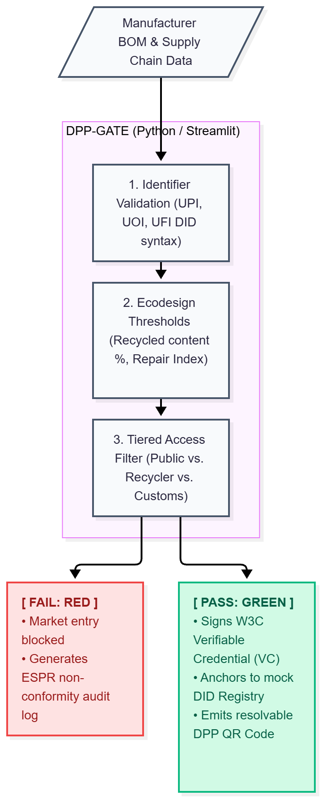

# 🛡️ DPP-Gate: Ecodesign Techno-Regulatory Gateway

Disclaimer: Developed as an academic prototype exploring AI, Techno-regulation, and the Circular Economy.

**DPP-Gate** is a functional software prototype demonstrating "Compliance-by-Design" within the context of the European Union's Ecodesign for Sustainable Products Regulation (ESPR). 

By translating legal requirements into hardcoded architectural constraints, this tool explores the concept of **techno-regulation** (or **"Code is Law"**). It physically prevents the issuance of a Digital Product Passport (DPP) if a product's supply chain metrics fail to meet statutory environmental thresholds.

## 📖 Theoretical Context

Traditional normative law relies on post-market audits and paper trails. DPP-Gate replaces this with **technological management** (Roger Brownsword). The system acts as a digital border guard:
- **Decentralized Identifiers (DIDs):** Enforces the use of standardized URIs for the Unique Product Identifier (UPI), Operator (UOI), and Facility (UFI).
- **Code-as-Law Execution:** Evaluates Bills of Material (BOM) against hardcoded delegated acts (e.g., minimum recycled content).
- **W3C Verifiable Credentials (VCs):** If compliance is proven, the system mints a cryptographically signed JSON-LD payload, proving conformity without exposing proprietary trade secrets to a central database.

### The Prototype: "DPP-Gate" (Compliance-by-Design for Circularity)

#### The Scenario & Legal Grounding

Under the ESPR, products (starting with textiles, batteries, and electronics) cannot legally enter or circulate within the EU single market without a compliant Digital Product Passport. The regulation establishes strict ecodesign requirements (such as minimum recycled content and reparability scores) alongside data integrity rules (mandatory UPI, UOI, and UFI identifiers).

#### The Techno-Regulatory Mechanism

Instead of relying on retrospective paper audits by customs or market surveillance authorities (normative law), DPP-Gate acts as an architectural gatekeeper (technological management / "Code is Law"). A manufacturer inputs their Bill of Materials (BOM) and component disclosures. The engine evaluates the product against delegated ecodesign criteria and cryptographically validates the supply chain identifiers.

If the product fails ecodesign thresholds, the system physically denies the creation of the passport and blocks QR code generation. If it passes, it mints a W3C Verifiable Credential (VC) signed by the manufacturer’s DID, maps the UPI, UOI, and UFI, and produces the consumer-facing DPP.

## ✨ Features

- **Automated Market Conformity Evaluation:** Cross-references product data with ESPR delegated act limits.
- **Architectural Blockades:** Suppresses QR code generation and blocks market entry if environmental metrics fail.
- **Cryptographic Attestation:** Generates W3C-compliant Verifiable Credentials using mock Ed25519 signatures.
- **Real-time Data Carrier:** Renders a live, scannable QR code resolving to the product's decentralized identity.

## 🛠️ Tech Stack

- **Language:** Python 3.12
- **Frontend/Framework:** [Streamlit](https://streamlit.io/)
- **Utilities:** `qrcode`, `Pillow` (for live QR generation), `hashlib` (for mock cryptographic proofs)

## 🚀 Installation & Setup

- Clone or create the project directory: `git clone --`
- Create a virtual environment: `python -m venv venv`
- Activate the virtual environment: 
    - on macOS/Linux: `source venv/bin/activate`
    - on Windows: `venv\Scripts\activate`
- Install the required dependencies: `pip install -r requirements.txt`

## 💻 Running the Prototype

Start the Streamlit development server: `streamlit run app.py`

The application can be opened in your browser at http://localhost:8501.

## 🧪 Demonstration Guide (How to Use)

The sidebar selections are:
- `Min Recycled Plastic (%)`
- `Min Repairability Index (0-10)`

The values are given by the state; the simulation here is that we change it according to the rules of the state at each moment

The initial values are set to 
- `Min Recycled Plastic (%) = 35`
- `Min Repairability Index (0-10) = 6.5`

### Scenario A: Compliant Product (Credential Minting)

- Adjust the Post-Consumer Recycled Content (%) to 35 and above 
- Ensure the Repairability Index is 6.5 and above.
- Set the `Contains Substances of Very High Concern (SVHC > 0.1%)?` to No
- the Entity & Product Identifiers must start with `did`:
    - `Unique Product Identifier (UPI)`, 
    - `Unique Operator Identifier (UOI)`, and
    - `Unique Facility Identifier (UFI)` 
- Click Evaluate Market Conformity.

Result: The system verifies the data, mints a W3C Verifiable Credential signed by the supplier's DID, and generates a live QR code acting as the product's digital data carrier.

### Scenario B: Non-Compliant Product (Techno-Legal Blockade)

- In the sidebar, leave the minimum recycled content threshold at 30%.
- In the main form, enter 15% for the product's Post-Consumer Recycled Content.
- Click Evaluate Market Conformity.

Result: The system flashes red, cites the statutory failure, and blocks the generation of both the Verifiable Credential and the QR code.

This scenario also holds for the other parameters in the main form
-  Repairability Index below 6.5.
or
- Set the `Contains Substances of Very High Concern (SVHC > 0.1%)?` to Yes
or any of the  Entity & Product Identifiers does not start with `did:`
